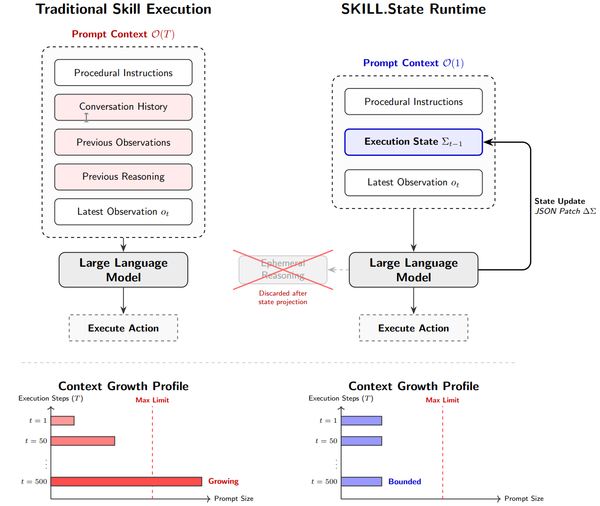

# markov-agent

A coding agent following the principles defined in the [SKILL.state](docs/paper.md) paper:

> Runtime architecture that replaces append-only conversational history with an explicit, mutable execution state. At each execution step, the model receives only the immutable skill specification, the current structured execution state, and the latest observation. Intermediate reasoning is discarded immediately after **producing a validated state update**, preventing prompt growth with execution history.



Hence, the context given to the agent is modeled similar to a Markov process: the next state depends only on the current one and the (observed result of the) action taken.

## Overview

Although the paper specifies tasks like inventory management or CTF, I wanted to use it for a coding agent and test it in tasks I normally throw at [Pi](https://github.com/earendil-works/pi) and see what happens.

The action space is: **bash**. Nothing more and nothing less. While most coding agents have some specially guardrailed tools (`read`, `patch`, etc.), [there is research proving that powerful LMs can do better without](https://arxiv.org/pdf/2609.20804):

> Predefined tools improve performance for models with weaker bash proficiency, whereas bash-capable models can operate effectively with a bash-only interface and achieve substantially lower cost, especially on command-line-centric tasks.

## Installation

```bash
uv add markov-agent
```

## Usage

### TUI

```bash
uv tool install markov-agent
markov  # --model defaults to mistral:mistral-large-4
```

### Settings

Press `ctrl+s` in the TUI to open the settings screen: pick the model (`provider:model-id`, validated
through `lmdk`) and enter provider API keys. `escape` closes without writing; the screen is unavailable
while a turn is running.

Saved settings live in `~/.markov/config.json` (an older `~/.markov/auth.json` is renamed on first run):

```json
{ "model": "mistral:mistral-large-4", "keys": { "MISTRAL_API_KEY": "..." }, "theme": "textual-dark" }
```

The file is written atomically with mode `0600` inside a `0700` directory, and its keys are merged into
the environment at startup — a variable already set in the real environment always wins over the file,
so `MISTRAL_API_KEY=... markov` keeps working. Key values are never printed or logged; the settings
screen only shows them masked (`sk-…abcd`) next to their source (`env` or `config.json`). The `--model`
flag still works and takes precedence over the file for that run.

`ctrl+p` opens Textual's command palette. A theme picked there is written to `config.json`, so the next
run starts with it.

### As a library

[`skill_state.py`](src/markov_agent/skill_state.py) is the whole implementation of the paper. Define your
state as a pydantic model plus an immutable instruction block, then consume the `StepEvent`s of
`run()`. [`agent.py`](src/markov_agent/agent.py) is a small coding-agent domain to copy from.

If you only want the core and not the terminal UI (nor its `textual` dependency), copy
`skill_state.py` and `prompt_template.jinja` into your project: they import nothing else from this
package, and `lmdk` + `jinja2` are their only requirements.

## Development

This project uses [uv](https://docs.astral.sh/uv/), [just](https://just.systems/) and [prek](https://github.com/j178/prek).

See [justfile](justfile) for pre-built commands used along pre-commit hooks and CI.

_Made with [`mold`](https://github.com/nachollorca/mold) template_

## References

```
@misc{badhe2026skillstatescalablelonghorizonagent,
      title={SKILL.state: Scalable Long-Horizon Agent Skills},
      author={Sanket Badhe and Priyanka Tiwari and Jonghyun Chung},
      year={2026},
      eprint={2608.26263},
      archivePrefix={arXiv},
      primaryClass={cs.AI},
      url={https://arxiv.org/abs/2608.26263},
}
```
